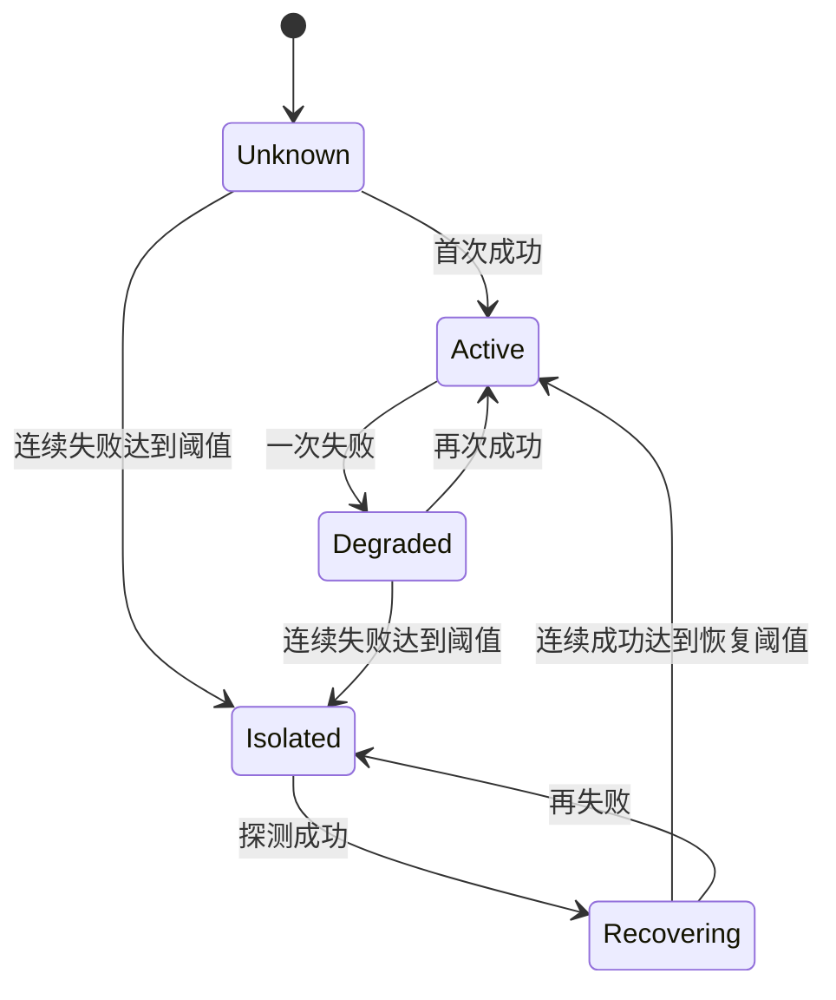
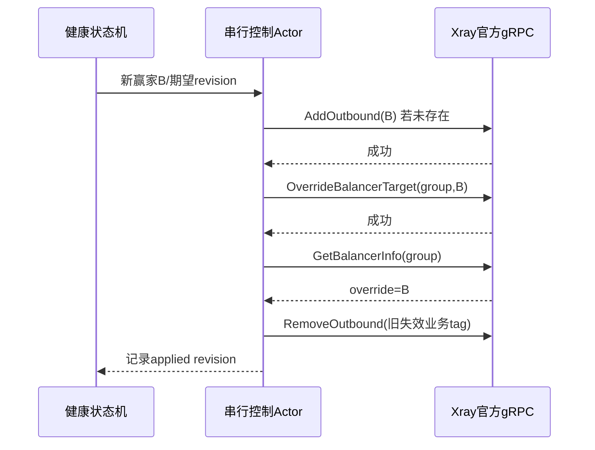
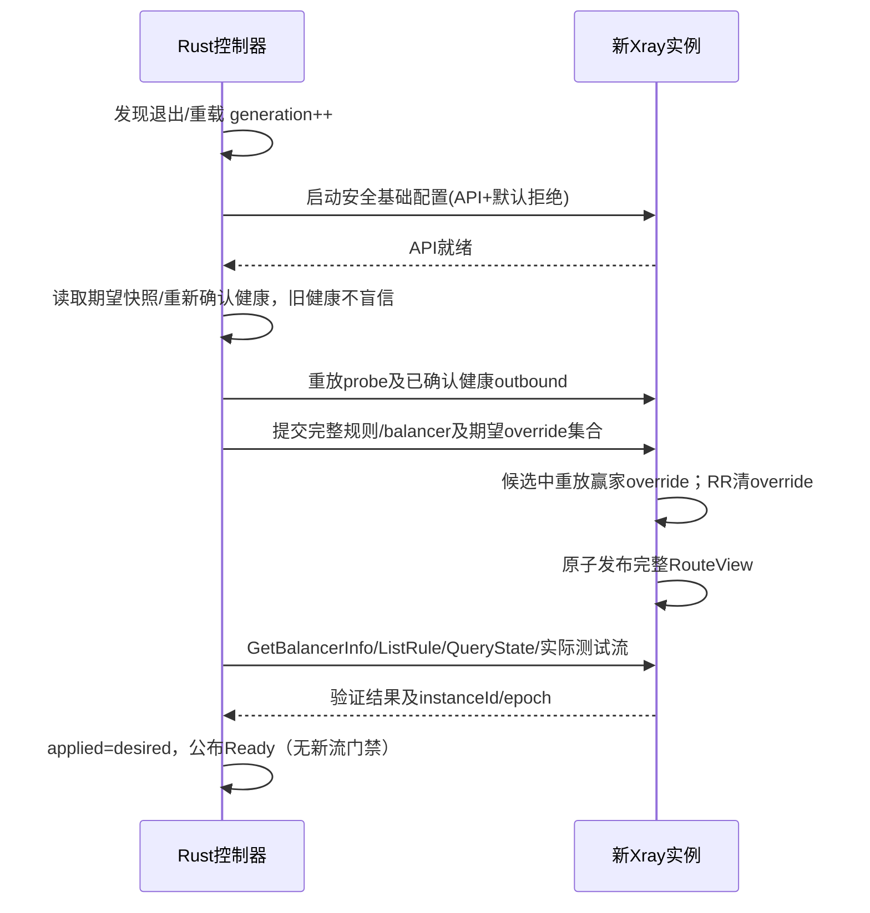
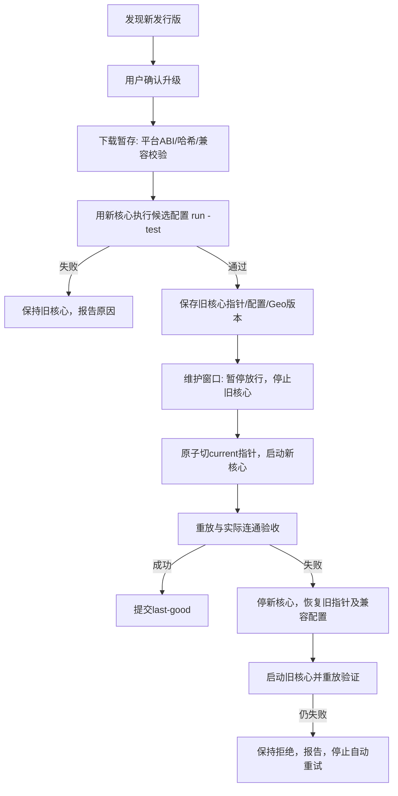
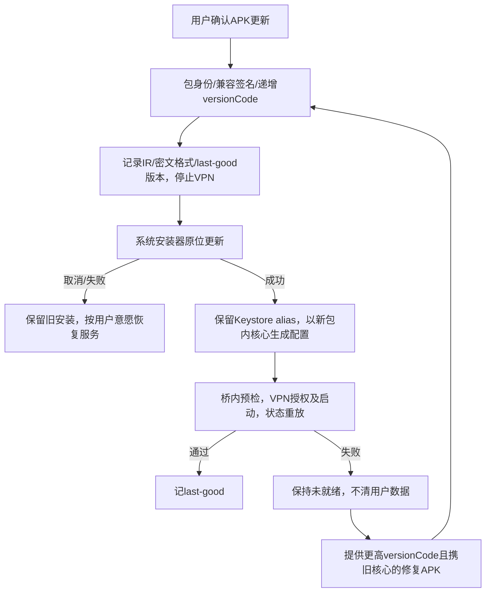
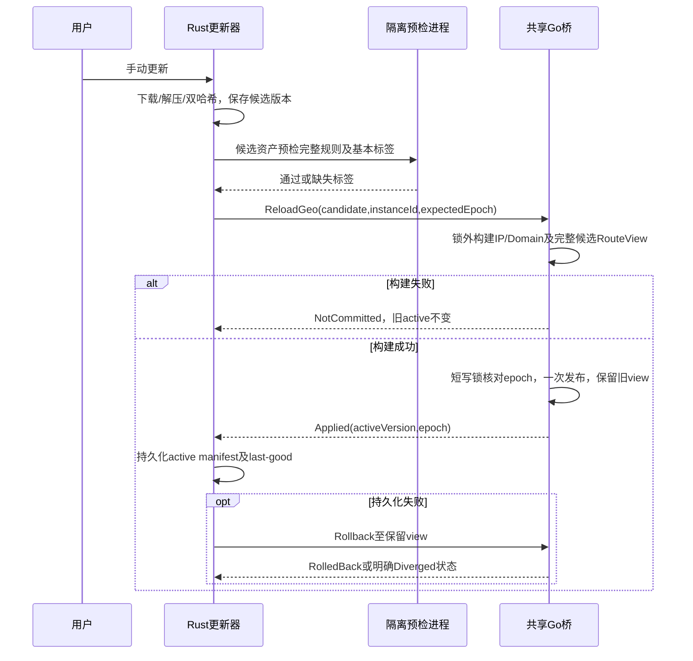

# pCryoxy 工程蓝图 v0.2（G1～G5裁定修订版）

- 项目: pCryoxy
- 版本: v0.2（G1～G5 裁定修订版；v0.1 已获用户审核通过，v0.2 为现行版本）
- 发布状态: 已发布 · 共享权威正文（后续维护的唯一权威版本）
- 发布: workbuddy@zhn-tbxg2iah-win~zhn-x-w｜2026-11-19
- 发布记录与统一入口: `2026-11-19-pCryoxy任务认领入口-zhn-tbxg2iah-win.md`
- 演进关系: v0.1（已审核通过）→ v0.2（落实 2026-11-19 12:40 的 G1～G5 最终裁定）；发布前编辑沿用历史文件名 `pCryoxy-工程蓝图-v0.1-待审核.md`，本次发布按正文版本更名为 v0.2，技术范围与已批准裁定未改动。
- 权威性: 会话工作区同名源文件（`pCryoxy-工程蓝图-v0.1-待审核.md`）为发布前历史快照，仅作可恢复副本，不再更新。

日期：2026-11-19。v0.1 已获用户审核通过，12:40 最终裁定已落实为 v0.2；发布前编辑为保持既有链接曾原位修订并保留历史 v0.1 文件名，本次发布已按规定更名为 v0.2，正文版本以本文件抬头为准。用户授权编制实施任务卡与逐文件接口契约；未授权本轮安装依赖、建仓、认领实施卡或编码。pRayShell 不受影响。配套文件：`2026-11-19-pCryoxy-实施任务卡-v1.0-zhn-tbxg2iah-win.md`、`2026-11-19-pCryoxy-API-Spec-v1.0-zhn-tbxg2iah-win.md`。

## 0. 结论、变更与证据等级

1. REQ-10 按最新裁定细化：故障转移、最低延迟由 Rust 唯一选赢家；轮询由 Rust 管理健康集合，Xray roundRobin 唯一决定每次新路由分发。两层权限不同，不同时争抢出口。
2. 核心核验基线为正式发行版 v26.11.9，对应提交 `676eaf66f8f05d4d558ee7a74b4736623d3feeb9`。这是本稿设计基准，后续须建立发行版能力矩阵、锁文件及构建验证，不能把 main 的新能力移植为发行版保证。
3. 已核实 RPC、selector 缓存失效、路由快照发布、Geo 预检和系统安全存储边界；未运行二进制、未编译 Rust／Android 桥、未逐项解析 DAT、未进行性能或互通测试。
4. **G1 已批准：**固定源码薄Go桥共用于Windows和Android；取消所有SetAdmission、新流拒绝门禁。用prepare/publish分离和完整版本快照保证路由、override及Geo的一致性。仅在桥外围加mutex不充分：补丁必须接入真实读路径，任务卡PC-04专门验证，不以新抽象框架代替最小上游补丁。
5. **G2 已批准：**八字段公式保持不变；其他语义参数冲突返回FingerprintConflict，由用户处理，不静默覆盖。
6. **G3 已批准：**Android采用独立:proxy服务、protect回调；固定提交实际存在原生tun入站与XRAY_TUN_FD，优先验证此路线，不预置第三方tun-adapter。
7. **G4/G5 已批准：**P0入口拒绝Member::Group，保留预留类型但不实现DAG展开；30s/5s/16并发/3失败/2恢复/50ms及RR仅Active、其他策略容忍Degraded生效。首次Unknown成功进入Active不属于隔离后恢复，保持原定义。

## 1. Rust Workspace 与目录

以下为拟建目录树，不表示文件已创建。generated 只存生成结果；文档和测试夹具不得含真实节点凭据。

```text
pCryoxy/
├── Cargo.toml                    # workspace members、统一 edition/MSRV
├── Cargo.lock                    # 应用工作区锁定依赖
├── package.json                  # 前端 scripts，CLI 仅本地 devDependency
├── pnpm-lock.yaml                # 包管理器提案，审核后锁定
├── contracts/
│   ├── core-lock.json            # core tag、commit、平台资产及校验值
│   ├── geo-lock.json             # 数据 tag、资产名、哈希、所需标签
│   └── redact-policy.json        # 日志/AI可出机字段白名单
├── crates/
│   ├── core-ir/src/
│   │   ├── lib.rs
│   │   ├── node.rs               # Node/协议与传输类型
│   │   ├── group.rs              # ProxyGroup/策略
│   │   ├── routing.rs            # RoutingRule/条件与动作
│   │   └── validated.rs          # 私有构造的 ValidatedSnapshot
│   ├── plugin-sdk/src/lib.rs     # 核心能力、计划与必要Trait
│   ├── protocol-parser/src/
│   │   ├── lib.rs                # 分享链接/订阅入口
│   │   ├── canonical.rs          # 八字段规范化与指纹
│   │   └── validate.rs           # 语义/引用一次校验；P0拒绝嵌套
│   ├── engine-scheduler/src/
│   │   ├── lib.rs
│   │   ├── health.rs             # 健康转移
│   │   ├── select.rs             # 优先级故障转移/最低延迟
│   │   ├── reconcile.rs          # 单写者期望态/实际态对账
│   │   └── probe.rs              # 经隔离探测出站执行204
│   ├── plugin-xray/
│   │   ├── build.rs              # 固定proto输入生成tonic/prost
│   │   ├── proto.lock            # 上游提交/文件摘要/生成器版本
│   │   ├── proto/                # 上游proto及递归imports，只读
│   │   └── src/
│   │       ├── lib.rs
│   │       ├── config.rs         # IR→JSON/typed protobuf
│   │       ├── rpc.rs            # 官方RPC适配
│   │       ├── replay.rs         # generation变化后的状态重放
│   │       └── generated/        # GENERATED，禁止手改
│   ├── core-updater/src/
│   │   ├── lib.rs
│   │   ├── manifest.rs           # 版本/ABI/完整性/兼容性入口
│   │   ├── windows.rs            # 独立核心版本目录及回退
│   │   └── geo.rs                # 下载/解压/预检/激活/恢复
│   ├── secure-store/src/
│   │   ├── lib.rs
│   │   ├── windows.rs            # Credential Manager
│   │   └── android.rs            # JNI→Keystore加解密
│   ├── plugin-ai-agent/src/
│   │   ├── lib.rs                # P1，非关键路径
│   │   ├── safe_context.rs       # 白名单脱敏DTO
│   │   └── tools.rs              # 操作提案与确认令牌
│   └── tauri-app/
│       ├── Cargo.toml
│       ├── tauri.conf.json
│       ├── capabilities/
│       ├── src/{main.rs,lib.rs,commands.rs,state.rs}
│       └── gen/android/          # Tauri生成，不零散修改生成配置
├── ui/src/
│   ├── main.tsx
│   ├── routes/{Nodes,Groups,Routing,Updates,Settings}.tsx
│   ├── components/
│   ├── stores/telemetry.ts       # 合并批量事件，不逐点触发IPC
│   └── api/                     # 明确DTO，不接触密钥和核心JSON
├── native/
│   ├── android/                 # 手写移动插件源，由构建接入gen目录
│   │   ├── ProxyVpnService.kt
│   │   ├── SecretStore.kt
│   │   └── CoreBridge.kt
│   ├── xray-bridge/             # G1/G3已批准，待按卡实现
│   │   ├── go.mod
│   │   ├── core_control.proto   # pcryoxy.bridge.v1，非官方RPC
│   │   ├── runtime.go           # 固定Xray启动/预检/停止
│   │   ├── geo_reload.go        # prepare/publish/内存恢复
│   │   ├── snapshot.go          # 完整RouteView及短锁发布
│   │   └── upstream-patches/    # 固定提交最小补丁，注明目的/来源
│   └── （不预建tun-adapter）    # 原生TUN有明确障碍再申请替代
├── tests/{fixtures,contracts,integration,platform}/
├── tools/                       # proto生成、锁定、包体分解脚本
└── docs/                        # 蓝图、ADR、审核记录；尚无实施任务卡
```

依赖方向：core-ir 无平台依赖；plugin-sdk→core-ir；parser/scheduler/xray→sdk与IR；updater 调用运行时/Geo端口，不依赖 UI；tauri-app 为组合根。安全存储仅交给受信任核心控制与解析入口，AI 和 UI 没有任意读取密钥权限。

基础依赖提案：Tokio（异步）、serde（边界序列化）、tonic/prost（官方gRPC）、sha2（指定SHA256）、HTTP客户端及 gzip 解码库（订阅/更新）、Windows API bindings；按实际使用选最小feature。以上没有安装，没有把未批准依赖写进真实 Cargo.toml。Android 原生加密使用平台API，不再引入重复加密框架。

## 2. 精简 IR 与核心 Trait

以下为设计级 Rust 定义：展示字段、所有权与接口契约，非完整可编译 crate。未展开的协议参数类型必须在实现前按固定proto逐项完成，不以 String JSON 逃避强类型。内部不能序列化完整 Node 到日志或 AI。

```rust
use std::{future::Future, num::{NonZeroU16, NonZeroU64}, time::Duration};

#[derive(Clone, Copy, PartialEq, Eq, Hash)]
pub struct NodeId(pub u64);
#[derive(Clone, Copy, PartialEq, Eq, Hash)]
pub struct GroupId(pub u64);
#[derive(Clone, Copy, PartialEq, Eq, Hash)]
pub struct RuleId(pub u64);
#[derive(Clone, Copy, PartialEq, Eq, Hash)]
pub struct SecretRef(pub u64); // 本地句柄，不是凭据内容
#[derive(Clone, PartialEq, Eq)]
pub struct Fingerprint(pub [u8; 32]);

pub enum Protocol { Vless, Vmess, Trojan, Shadowsocks, Hysteria2, WireGuard, Masque }
pub enum Transport { Raw, XHttp, WebSocket, HttpUpgrade, Grpc, Quic, Native }
pub enum Security { None, Tls, Reality }
pub enum NodeState { Unknown, Active, Degraded, Isolated, Recovering }
pub struct Endpoint { pub address: String, pub port: NonZeroU16 }

// 以下每种类型承载协议专有的已校验参数，不包含明文密钥。
pub enum ProtocolOptions {
    Vless(VlessOptions), Vmess(VmessOptions), Trojan,
    Shadowsocks(SsOptions), Hysteria2(Hy2Options),
    WireGuard(WgOptions), Masque(MasqueOptions),
}
pub struct LinkOptions {
    pub transport: Transport,
    pub security: Security,
    pub sni: Option<String>,
    pub path_or_service_name: Option<String>,
    pub transport_options: TransportOptions,
    pub security_options: SecurityOptions,
    pub final_mask: Option<FinalMaskOptions>,
}
pub struct Node {
    pub id: NodeId,
    pub display_name: String,
    pub endpoint: Endpoint,
    pub protocol: Protocol,
    pub options: ProtocolOptions,
    pub credentials: SecretRef,
    pub credential_id: [u8; 32],
    pub link: LinkOptions,
    pub fingerprint: Fingerprint,
    pub state: NodeState,
}
pub enum Strategy {
    Failover, // members 顺序为人工优先级；首个健康者胜出
    LowestLatency { tolerance: Duration },
    RoundRobin,
}
pub enum Member { Node(NodeId), Group(GroupId) }
pub struct ProxyGroup {
    pub id: GroupId,
    pub name: String,
    pub strategy: Strategy,
    pub members: Vec<Member>,
}
pub enum DomainMatch { Exact(String), Suffix(String), Keyword(String), GeoSite(String) }
pub enum IpMatch { Cidr(IpCidr), GeoIp(String) }
pub enum Network { Tcp, Udp }
pub enum SniffProtocol { Http, Tls, Quic, BitTorrent }
pub struct PortRange { pub first: u16, pub last: u16 }
pub struct Match {
    pub domains: Vec<DomainMatch>,
    pub ips: Vec<IpMatch>,
    pub ports: Vec<PortRange>,
    pub networks: Vec<Network>,
    pub sniff: Vec<SniffProtocol>,
}
pub enum Action { Direct, Reject, Node(NodeId), Group(GroupId) }
pub struct RoutingRule {
    pub id: RuleId,
    pub enabled: bool,
    pub when: Match,
    pub action: Action,
}
pub struct Snapshot {
    pub revision: NonZeroU64,
    pub nodes: Vec<Node>,
    pub groups: Vec<ProxyGroup>,
    pub rules: Vec<RoutingRule>, // Vec顺序即优先级，不另存重复priority
}
pub struct ValidatedSnapshot(Snapshot); // 构造器仅在入口校验模块开放
```

IpCidr 必须是解析后的网络地址与前缀长度；不能用任意字符串流经内部。ProtocolOptions/TransportOptions/SecurityOptions 展开依据协议矩阵：VLESS flow/encryption、SS cipher、REALITY public key/short id、TLS证书固定、XHTTP模式、WireGuard peers等；秘密材料保存在 vault，非秘密但可识别信息也不进入遥测。原始输入兼容性处理在 parser 一次完成。

规则语义：一个字段列表内 OR，不同字段间 AND；空 Match 仅允许明确的末尾兜底，入口检查位置。最终生成器按 Xray 真实字段映射，禁止空字段误扩大匹配。Android 应用选择属于 VPN 设置，不放进跨平台 RoutingRule。

```rust
pub enum CoreError {
    UnsupportedCapability, InvalidConfig, Unavailable,
    DeadlineUnknown, Rejected, VerificationFailed,
}
pub enum ReloadMode { Append, Replace }
pub struct CoreGeneration(pub u64);
pub struct ApplyReceipt { pub generation: CoreGeneration, pub revision: u64 }
pub struct Traffic { pub uplink_bytes: u64, pub downlink_bytes: u64 }

// 使用静态泛型组合，不为单个实现引入对象安全和async-trait依赖。
pub trait ProxyCorePlugin: Send {
    fn start(&mut self, cfg: &ValidatedSnapshot)
        -> impl Future<Output=Result<CoreGeneration, CoreError>> + Send;
    fn stop(&mut self) -> impl Future<Output=Result<(), CoreError>> + Send;
    fn hot_reload(&mut self, plan: RoutePlan)
        -> impl Future<Output=Result<ApplyReceipt, CoreError>> + Send;
    fn sync_outbounds(&mut self, delta: OutboundDelta)
        -> impl Future<Output=Result<ApplyReceipt, CoreError>> + Send;
    fn set_target(&mut self, group: GroupId, target: Target)
        -> impl Future<Output=Result<(), CoreError>> + Send;
    fn get_traffic_stats(&mut self)
        -> impl Future<Output=Result<Traffic, CoreError>> + Send;
}
pub enum Target { Node(NodeId), Reject, NativeRoundRobin }
pub struct OutboundDelta {
    pub add: Vec<OutboundSpec>,
    pub remove_tags: Vec<String>,
}
pub struct RoutePlan {
    pub revision: u64,
    pub mode: ReloadMode,
    pub snapshot: ValidatedSnapshot,
}
pub trait ProtocolParserPlugin {
    fn parse(&self, input: &[u8], secrets: &mut impl SecretStore)
        -> Result<ValidatedSnapshot, InputError>;
}
pub trait SecretStore {
    fn put(&mut self, value: &[u8]) -> Result<SecretRef, SecretError>;
    fn with_secret<T>(&self, id: SecretRef, f: impl FnOnce(&[u8]) -> T)
        -> Result<T, SecretError>;
}
```

RoutePlan、OutboundSpec 是经过 plan 构造器生成的内部类型；构造器负责 tags/依赖排序，不接受 UI 自带 protobuf。RPC 失败、generation 改变是运行时事实，不属于重复输入校验。策略用 enum＋纯函数即可，不再为三个分支新增 RoutingStrategyPlugin 层层工厂；未来真实扩展时再抽象。AI P1 使用具体服务方法 `propose(SafeContext) -> ToolProposal`，不是任意 shell 接口。

### 2.1 八字段指纹与入口唯一校验

逻辑公式保持用户裁定：

```text
SHA256(protocol | address | port | credential_id |
       transport_method | security_type | sni | path_or_service_name)
```

实现序列化采用固定版本前缀 `pcryoxy-node-v1`＋每字段 u32大端长度＋UTF-8/固定字节，避免 path 内 `|` 等分隔符歧义。协议/传输/安全类型固定小写枚举；域名 IDNA 规范化并小写，IP用规范文本，去域名末尾点；不解析DNS后把域名替换IP；端口固定整数；SNI同域名规则。path/service保留大小写和语义，不盲目URL解码；缺省值按固定协议规范化，None与有效空值的映射写入测试。

credential_id 是 vault 中规范化凭据集合的本地键控指纹（建议 HMAC-SHA256，设备随机密钥受安全存储保护），不是随机 SecretRef，也不是明文密码/可离线猜测的裸密码哈希。这样相同凭据导入仍去重，不把密码直接进入最终公式；该ID不作为跨设备公共身份。

指纹不含名称备注。入口命中同指纹后比较完整非显示语义：若仅名称不同，可合并别名；若 ALPN、REALITY short id/public key、VLESS flow、FinalMask 等八字段外参数不同，返回 `FingerprintConflict`，由用户保留/修改，禁止悄悄覆盖。扩充八字段公式不是本稿擅自决策。

### 2.2 P0策略组入口校验

所有创建、编辑、导入和未来AI工具使用同一validate_snapshot入口。P0遇到任何Member::Group直接返回NestedGroupNotSupported，不保存候选、不运行DAG展开、不悄悄扁平化；因此P0不会产生组环。Member::Group仅保留在内部类型，不在P0前端可选项出现。节点引用存在、组成员不重复、路由引用合法在入口一次校验。完整候选通过后才能替换期望快照；内部模块不重复检查。

后续若批准完整嵌套策略组合，必须先恢复全图三色DFS防环并定义子策略语义。该工作属于后续功能，不加入P0任务卡。

## 3. Xray运行时契约

### 3.1 官方RPC与消息

| 全限定方法 | 请求关键字段 | 用途 |
|---|---|---|
| /xray.app.router.command.RoutingService/OverrideBalancerTarget | balancerTag、target | 锁定赢家；target空字符串清除override |
| /xray.app.router.command.RoutingService/AddRule | config: TypedMessage、shouldAppend | 追加或完整替换规则及balancer |
| /xray.app.router.command.RoutingService/RemoveRule | ruleTag | 移除规则，不移除balancer |
| /xray.app.proxyman.command.HandlerService/AddOutbound | outbound: core.OutboundHandlerConfig | 注册出站 |
| /xray.app.proxyman.command.HandlerService/RemoveOutbound | tag | 注销出站 |

TypedMessage.type 是 descriptor FullName，不是 Any URL；value 是 protobuf二进制，不是JSON。AddRule封装 `xray.app.router.Config`；出站 sender_settings 为 `xray.app.proxyman.SenderConfig`，proxy_settings 为具体协议配置的类型与编码。proto生成需包含递归imports和对应协议消息。不能把 Go JSON配置直接塞进 value。

AddRule.shouldAppend=false 是全量替换，必须显式赋值；true只追加在旧规则之后，末尾兜底会遮蔽追加项。调整排序采用完整快照替换；同名balancer追加会失败，RemoveRule不删balancer。全量替换重建balancer，丢失override和轮询索引。规则构建失败不发布前半批，但多个RPC、balancer map和规则列表不是一个全局事务。API超时是结果未知，先对账，不能盲目追加重试。

### 3.2 安全默认配置与tag约定

- 第一个默认 outbound 为常驻 blackhole：`sys/reject`；显式直连为 `sys/direct`。二者永不放入动态池，不删除默认出站。
- `pool/<group-id>/<node-id>/<config-rev>` 是业务池tag；selector固定前缀 `pool/<group-id>/`。selector实际是前缀匹配，不是正则。
- `probe/<node-id>/<config-rev>` 是探测专用tag，不能被业务selector匹配。隔离业务出站后仍通过它检测恢复。
- 所有业务规则指向balancer；直连规则显式指向sys/direct。RR fallbackTag留空，避免原生观测器再次筛选健康集合；空池选路失败时默认拒绝，不漏向直连。
- 不配置原生leastPing/leastLoad自动决策，不启用与Rust健康相竞争的burstObservatory。未来单独原生模式需独立能力开关。
- 默认关闭 Mux，以清楚测试“每次新代理路由选择”；HTTP keep-alive复用、UDP会话、QUIC流不等同于每个请求/包均匀轮询。
- 官方API仅监听回环地址，端口动态分配但不向UI暴露控制权限；回环不等于同用户进程隔离。若要求强认证，需受控桥鉴权/OS访问限制，不能声称官方API已有token。

### 3.3 策略算法与健康机（G5默认参数已批准）

轻量探测周期30秒、超时5秒、并发16，失败3次隔离，恢复连续成功2次，恢复探测周期30秒；可由用户配置，未按此实测。探测目标可配置，必须走指定probe出站，以目标204成功为有效结果；测速本身不自动改用户路由。



RR仅纳入Active；Degraded首次失败即移出RR池但不注销probe。故障转移/最低延迟容忍Degraded直至隔离阈值；两者池准入差异已由G5批准，必须在UI与真实链路测试中覆盖。

故障转移按成员人工顺序取首个可用节点，当前节点隔离后立即更换；回切需恢复阈值满足。最低延迟在可用节点中比较最近成功样本的窗口中位数；当前健康时仅在新候选快超过50ms且连续两轮更优时切换；当前隔离则无视50ms立即切。平局用成员顺序，不依赖HashMap随机序。全失效目标sys/reject。历史可用率仅统计已完成探测，取消不计失败。

### 3.4 热切换、轮询与重放

单个 Tokio actor 串行执行每实例的出站、路由、override变更；UI事件和探测结果只投递命令。desired revision持久化，applied revision只在确认后推进；RPC回执同时绑定generation，旧进程回执不能覆盖新状态。



不能先删除当前override目标。正常切换只改变新流选择；RemoveOutbound不主动Close既有handler，但“先选tag、后取handler”的在途竞态可失败，不承诺绝对零损。删除不会自动清override。恢复使用新revision tag，避免未关闭的旧handler和新连接语义混淆；长时间反复增删的资源释放需压力测试，不能声称注销即立即回收。

RR：首次设置override空串；Rust AddOutbound增加健康候选，RemoveOutbound隔离失效候选。Xray每次Balancer选路取selector候选，增删失效缓存，按排序tag轮询。池变化不保持原轮询序列；测试在稳定池窗口统计公平性，不要求变更瞬间严格等分。

路由全量替换：桥先在锁外构建候选rules、balancers、绑定的Geo matcher和override集合；对未发布的balancer完成重放，然后一次发布完整RouteView。读路径开始时取一个完整版本引用，释放短读锁后匹配/DNS/选路；不能持读锁等待DNS，否则可能阻塞写者或递归死锁。旧版本由在途读者持有，结束后回收；不在发布锁内等待webhook或关闭资源。没有SetAdmission，不关闭listener、不安装临时拒绝规则。源码规则对象已绑定Balancer指针，不能夸大为每次读取新旧两个map混拼；真实风险是重建后override丢失及live Geo matcher混代。

新增RouteView必须固定Geo状态而不只是拷贝rules slice。官方RoutingService的AddRule/RemoveRule/OverrideBalancerTarget保持原方法路径，但在受控构建中统一转到同一事务提交器；兼容v2ray服务名也不得旁路。全量替换在发布前自动重放权威override，无需外部多RPC事务；常态单赢家调用仍用OverrideBalancerTarget。bridge Operation/QueryState返回instanceId、单调epoch、已应用revision；generation不再混用进程代次与状态版本。补丁位置及接口见API Spec。



GetBalancerInfo/ListRule不是完整配置导出，也不能证明所有出站内容一致；应用维护自己独占实例的操作账本，并通过实际测试确认关键出口。RPC结果未知时先读可查状态；不可查的出站状态须使用新tag补偿/核对而不是无界重试。异常重启不恢复旧TCP连接和RR索引。

## 4. 双平台运行与核心升级

### Windows

应用用户数据目录：`core/versions/<version>/`、`core/current.json`、`geo/versions/<tag>/`、`vault/`、`config/`。版本目录不可变，切指针而不覆盖运行中的exe；current.json同卷临时写入后替换。保留原始用户IR和按核心版本生成的配置，配置含秘密时采用当前用户ACL、禁止备份/日志/提交。



SHA256来源与资产同源只证明传输一致性。签名/可信发布清单为供应链方案提案，审核批准后实现；本稿不凭空给出不存在的官方签名。更新窗口可中断存量，不能包装成无缝迁移。

### Android

首选路径：Tauri移动壳→独立:proxy进程的Kotlin VpnService→原生TUN fd→同进程Go桥内Xray原生tun入站。固定提交的infra/conf/tun.go、proxy/tun/tun_android.go和proxy/tun/README.md已确认支持XRAY_TUN_FD；不预引入第三方tun-adapter。原生路线需真实ABI/FD/TCP/UDP/DNS验证，出现可复现兼容障碍才提第三方替代，保护DNS绕行的缺口不能靠换TUN栈解决。

FD所有权：服务持有ParcelFileDescriptor；核心正常路径先设非阻塞再dup并关闭内部副本。上游SetNonblock失败分支会关闭传入fd，桥需在局部最小补丁中明确“成功dup之后才由核心拥有该副本”，不得让Kotlin继续关闭已被核心意外关闭且可能复用的描述符。启动前检查有效fd，清除冲突的xray.tun.fd；环境数字仅属于当前进程，不能跨进程只传整数。:proxy承载核心生命周期，UI进程通过同UID绑定服务通信。

通过RegisterDialerController接入RawConn.Control，同步VpnService.protect(fd)，false必须转拨号失败；回调不得关闭借用socket fd，也不能排队异步protect。注册为进程级一次，重启核心不重复追加。默认TCP/UDP走该控制点，但DoQ直接quic.DialAddr、部分bootstrap/SRV/TXT及可选传输可能绕行，须逐组合审计和真机抓包。未覆盖组合只能标未通过，不擅自删除需求或宣称全支持；必要时补固定版本控制点。选择排除应用自身不是默认替代。VpnService前台通知、撤销、系统杀进程、切网和重连由平台层处理；IR不泄漏Android类型。



Android不自动安装低版本APK，不保证后台静默安装；同applicationId和兼容签名身份才能保数据。旧核心不支持新字段时显示不兼容项，不删除用户IR。移动预检用桥在隔离的验证实例调用固定版本配置构建，不能假装有可执行`xray run -test`文件；其等价性必须与Windows CLI合同测试对齐。VPN地址、DNS接管、IPv6、UDP支持、TUN适配器许可证和ABI仍是G3审核验证清单，不擅自宣称已完成。

## 5. Geo包预检、热加载与联合恢复

### 5.1 首次包与标签锁定

源固定为 XTLS/Xray-rules-dat。观察到数据发行tag `20261119000536`；资产选择提案 `geoip-lite.dat`＋`geosite.dat`，落盘映射 `geoip.dat`＋`geosite.dat`。首次随交付提供独立基础数据包，后续只手动下载。不能自动改用Full：Lite的cn是in-cn兼容别名，Full的cn是地理归属，替换会改变含义。

geo-lock记录tag、资产名、压缩哈希、解压哈希、分类集合、许可来源和语义。广告分类候选以实际DAT为准，不能把category-ads写死为一定存在；private/cn/geolocation-!cn等也必须对实际交付包逐一预检。缺必需标签则拒绝该包、保持旧包；若首次包不满足，阻断发布而不是删规则凑通过。

### 5.2 下载和预检算法

1. 手动触发，下载到私有staging版本目录；同步获取版本固定的校验清单。下载的大小/哈希、gzip解压上限是网络包边界处理，不把未知低概率风险层层传给内部。
2. .gz先验压缩摘要，再解压，验解压摘要；不覆盖活动目录。失败清理仅本次staging，保留last-good。
3. 从ValidatedSnapshot提取所有规则以及相关DNS配置引用的geoip/geosite文件和标签，生成临时完整预检配置：既包含当前实际规则，也包含基本标签覆盖用的测试规则。不得让优化器删掉待验证规则。
4. Windows启动**候选核心**子进程，`XRAY_LOCATION_ASSET=<staging绝对目录>`、`xray run -test -c <private-test-config>`；清除父环境冲突的`xray.location.asset`，避免其优先级覆盖。子进程工作目录隔离；所有引用资产必须在staging齐全，不能回退命中旧文件。
5. Android调用桥的同版本配置构建预检，显式指定候选asset根；不得在正在运行的核心进程里临时改全局环境变量造成竞态。必要时使用独立验证服务进程。仅返回脱敏错误码、缺失分类，不回传整份配置。
6. `run -test`验证构建过程中引用的数据，不是网络或端口测试。通过后才进入激活；首次运行之前也执行相同预检。

### 5.3 G1已批准的事务发布方案

官方 `geodata.cron` 无assets时只重载本地文件，不自动下载；但没有立即reload RPC，且IPReg.Reload与DomainReg.Reload不是联合事务。只等cron再看日志不能可靠宣告两种数据均已切换；覆盖文件也不能算完成。

**已批准实现方向：**固定上游提交的薄Go桥提供自有 `pcryoxy.bridge.v1.Control/ReloadGeo`（不是官方RoutingService）；Windows桥宿主和Android库共用逻辑，锁文件同时记录上游版本/桥版本/补丁摘要。请求带instanceId、expectedEpoch、candidateAssetVersion、snapshotRevision和operationId，响应区分未提交、已应用、已回滚及持久化不同步；完整字段见API Spec。

禁用原生geodata cron和assets下载，所有管理写入统一提交。把两类registry改为prepare候选及publish完整快照：候选解析/匹配器构建在锁外，任一失败则active不变；两类和路由引用都准备完后在短写锁内一次切换RouteView。读路径固定本次完整view，在锁外做DNS和匹配，不能继续从live DynamicMatcher读取新状态。保留last-good完整内存引用，回滚直接发布保留版本并递增epoch，不依赖再次加载可能损坏的旧文件。下载、解压、校验、资源关闭及网络等待均不得持发布锁。

磁盘版本指针和内存不能假装跨进程原子事务：先保留不可变版本目录及恢复记录，发布后持久化active manifest；持久化失败尝试发布旧保留快照并恢复指针，失败则返回DiskMemoryDiverged和真实active版本，不阻断业务新流。启动依据最后一次完整提交的last-good恢复。小型事务记录只为实际磁盘/内存双提交需要，不引入通用事务框架。没有SetAdmission、临时拒绝路由或停listener行为。详细补丁闭包与验收在PC-04/PC-12，不把桥外mutex当充分条件。



Windows/Android共用Geo事务，不因Geo更新而更新APK或常规重启核心。提交前已固定旧view的在途选路允许完成，新读者取得新view，不迁移存量连接；短锁等待不是主动拒绝新流，也不承诺零等待。DNS等其他Geo消费者必须固定一致view或明确标记能力不支持，不能只修路由而对全核心宣称一致。最小版本禁止未适配的Lua/script及domainStrategy热变更；不能静默丢掉用户配置。

## 6. 安全存储、日志和AI隔离

### 存储边界

| 对象 | Windows | Android |
|---|---|---|
| vault主密钥 | Credential Manager Generic Credential，当前用户本机持久化 | Android Keystore生成AES密钥，不导出 |
| 节点秘密/完整订阅URL/API key | 主密钥AEAD加密的应用私有vault文件 | Keystore AES-GCM加密，密文置noBackupFilesDir |
| 数据库/IR | 仅SecretRef及非秘密配置；仍不默认对外发送 | 同左 |
| 凭据明文使用 | 解析/核心生成局部作用域，缩短驻留，不打印 | Kotlin加解密与Go核心运行仍可能接触明文，不夸大非导出保护 |

Windows单条CredentialBlob上限2560字节，故不把整份订阅塞入；Credential Manager不是同用户进程隔离沙箱。Android Keystore不是任意token KV，也不保证所有设备硬件/StrongBox。AES-GCM每次加密唯一随机nonce、认证标签与格式版本属于正常算法契约。密钥失效则提示重新导入，不自动生成同alias覆盖旧数据。

后台运行不默认要求每次生物认证；该选择需平台审核，不能在服务运行期间弹验证导致断流。禁止系统备份设备绑定密文，导出必须显式操作并定义可移植加密格式，不能复制Keystore设备密钥。

### 强制脱敏通道

```rust
pub struct SafeNodeStatus {
    pub session_node_id: u32, // 对话内临时ID，不用真实端点或fingerprint
    pub state: SafeState,
    pub latency_ms: Option<u32>,
}
pub struct SafeContext {
    pub nodes: Vec<SafeNodeStatus>,
    pub error_codes: Vec<PublicErrorCode>,
    pub group_counts: Vec<u32>,
}
pub struct SafeEvent {
    pub code: PublicErrorCode,
    pub operation_id: u64,
    pub generation: u64,
}
```

只允许 `SafeEvent` 进日志sink，`SafeContext` 进AI网络客户端；两者构造器为唯一白名单投影。Node/SecretRef/vault/原始错误不实现通用Debug导出，不把用户节点名称、域名、订阅URL、SNI、证书、HTTP头、配置JSON混进“错误详情”。第三方错误统一映射为内部码，任何本地诊断展示也仅使用白名单字段与脱敏内容；不提供第三方错误原文直出旁路，不自动上报。

AI工具不直接改期望态：返回ToolProposal，用户确认后走与UI相同入口校验，绑定revision防止确认旧提案执行在新配置上。订阅地址由用户在本地输入，AI只拿占位引用；本轮不授权向AI发送凭据。强制脱敏是输出边界，不违反输入只校验一次。验证以携带可识别测试秘密的真实错误路径检查日志/HTTP请求，不依赖仅Mock成功用例。

## 7. 测试与审核检查表（不是任务卡）

| 范围 | 必须取得的真实证据 |
|---|---|
| 指纹 | 名称变化相等；REALITY与WS+TLS不同；分隔符无歧义；八字段外冲突不静默合并 |
| 策略组 | P0创建/导入/编辑均拒绝组成员引用；缺节点引用、重复成员及路由引用一次入口校验 |
| RPC | 固定proto真实核心测试；AddRule默认false危险路径；删除不存在tag；结果未知对账 |
| 轮询 | 3健康节点稳定窗口的新路由分发；增删后缓存失效；probe不入池；空池拒绝而非直连 |
| 切换 | 加赢家→override→删旧；存量长连接；重启与全量规则替换后重放；错代回执不生效 |
| Geo | 所需标签缺失、gzip损坏、校验错误、候选预检、IP成功Domain失败、旧内存恢复失败 |
| 核心更新 | 错ABI、配置不兼容、启动失败回退；Android同签名高versionCode旧核心保数据 |
| 平台 | Android TCP/UDP/DNS出站protect、防环、VPN撤销、后台重建；Windows系统代理退出恢复 |
| 安全 | 真实错误串含秘密也不入日志/AI；vault不进备份；Credential大小边界；密钥失效不覆盖 |
| 性能 | 单独本体/核心/Geo包体及完整APK/下载/安装；总RSS/PSS；首帧/可交互/代理就绪；高频刷新 |

固定发行版所有协议需各自真实互通夹具；不得以某一VLESS用例代表所有协议通过。Node只存在于文档，以上测试未执行。新增库、TUN组件、Go桥构建、持久化格式、性能预算均在审核后才冻结进实施契约。

## 8. 裁定落实与实施交接

G1～G5均已由用户批准并按简化要求修订，不再重复请求已作出的决定。工程任务卡与API Spec为本轮正式交付，卡面全部todo、未认领、未测试；实际开始编码前仍需项目接入、共享防撞认领、独立worktree及按卡审核。

PC-04先验证最小上游快照补丁闭包，PC-05先验证原生TUN真实设备路径；失败必须给明确证据，不能用新流门禁或未经批准的第三方栈掩盖。新发现的功能降级、破坏性迁移、依赖安装仍按七条铁律报告。性能目标不伪写为测试结果。

## 9. 官方证据索引

固定源码基准： https://github.com/XTLS/Xray-core/tree/676eaf66f8f05d4d558ee7a74b4736623d3feeb9

- Routing RPC：该提交 `app/router/command/command.proto`；Handler RPC：`app/proxyman/command/command.proto`。
- TypedMessage：`common/serial/typed_message.go`；出站配置：`core/config.proto`、`app/proxyman/outbound/handler.go`。
- 动态选择与注销：`app/router/balancing.go`、`app/proxyman/outbound/outbound.go`；默认出站回退：`app/dispatcher/default.go`。
- 规则快照：`app/router/router.go`；Geo加载与恢复限制：`app/geodata/geodata.go`、`common/geodata/ip_registry.go`、`common/geodata/domain_registry.go`。
- 预检：`main/run.go`；资产目录：`common/platform/platform.go`、`windows.go`、`others.go`。
- 官方全量文档：https://xtls.github.io/llms-full.txt
- 规则数据：https://github.com/XTLS/Xray-rules-dat
- Geo文档：https://xtls.github.io/en/config/geodata.html
- Windows凭据：https://learn.microsoft.com/en-us/windows/win32/api/wincred/ns-wincred-credentialw
- Android密钥：https://developer.android.com/privacy-and-security/keystore
- Android签名：https://developer.android.com/studio/publish/app-signing
- Android备份：https://developer.android.com/guide/topics/data/autobackup

官方事实与本稿提案分离：pcryoxy.bridge.v1、Rust类型、目录、参数、算法和测试设计均为本项目提案，不能引用为Xray原生能力。
